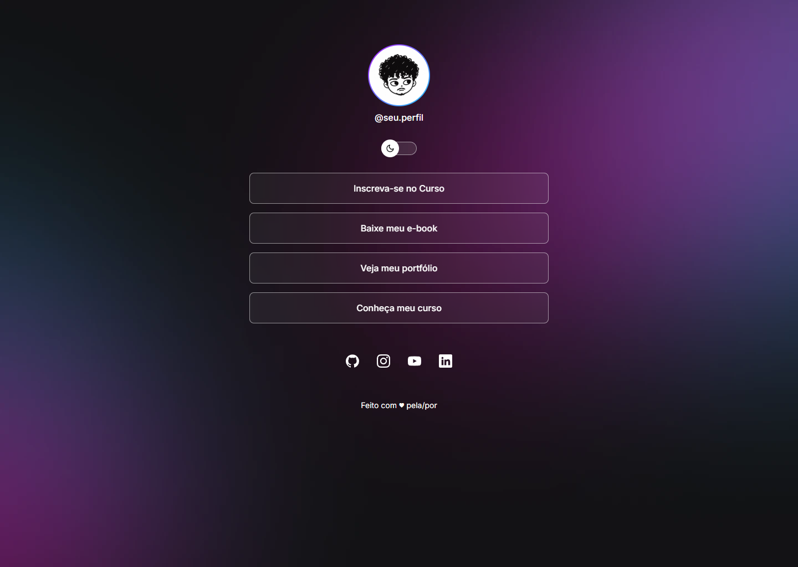
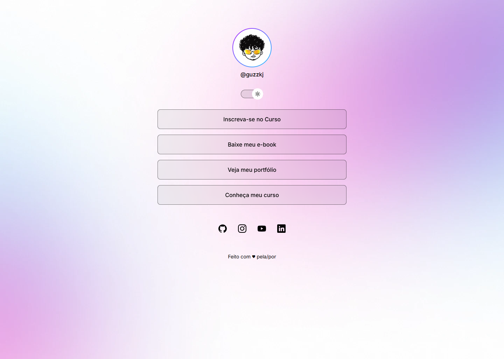
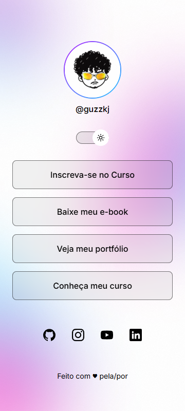

# DevLinks

Página de links pessoais (estilo "link na bio") feita em **React** a partir do design do
[Figma](https://www.figma.com/design/zxErkHjdi0J3yZmZdUMnQE/DevLinks-%E2%80%A2-OpenCode-MiniProject),
com **modo claro e escuro**, layout responsivo (mobile 360px e desktop 1440px) e desenvolvimento
guiado por IA com o arquivo [`AGENTS.md`](AGENTS.md).

## Prévia

| Desktop (escuro) | Desktop (claro) |
| --- | --- |
|  |  |

| Mobile (escuro) | Mobile (claro) |
| --- | --- |
|  |  |

## O que a página faz

- Mostra avatar, @usuário, 4 botões de links e 4 redes sociais (GitHub, Instagram, YouTube, LinkedIn).
- Abre os links externos em nova aba.
- Alterna entre modo claro e escuro (o avatar também muda de versão).
- Salva o tema no `localStorage`: ao recarregar, a escolha continua.
- Funciona por teclado (Tab/Enter) e tem textos alternativos e `aria-label`.

## Como instalar e executar

Requisitos: Node.js 20.19+ (ou 22.12+) e npm.

```bash
npm install
npm run dev
```

Abra o endereço mostrado no terminal (normalmente http://localhost:5173).

Outros comandos:

```bash
npm run build      # confere os tipos (tsc) e gera a versão de produção em dist/
npm run lint       # verifica o código (ESLint)
npm run test:e2e   # roda os testes Playwright (precisa do Google Chrome instalado)
```

## Como personalizar

Edite [`src/data/links.ts`](src/data/links.ts): nome de usuário, títulos e URLs dos botões e das redes sociais.

## Tecnologias

- React 19 + Vite + TypeScript
- CSS comum, com variáveis CSS para os temas
- Fonte Inter (Google Fonts)
- Playwright (testes automatizados)
- Context7 e Playwright MCP (configurados em [`.mcp.json`](.mcp.json))

## Estrutura

```
src/
  components/   Profile, LinkButton, ThemeToggle, SocialLinks, Icons, Footer
  data/         links.ts (perfil, links e redes sociais)
  types.ts      tipos TypeScript (Theme, LinkItem, SocialItem)
  assets/       avatars/ e backgrounds/
  App.tsx       estado do tema (useState + localStorage) e composição da página
e2e/            testes Playwright
evidencias/     capturas de tela e evidências de Context7 e Playwright
```

## Conceitos de React usados

- **Props** (tipadas com TypeScript): `LinkButton` recebe `title` e `url`; `Profile` recebe `avatar` e `username`;
  `ThemeToggle` recebe `theme` e `onToggle`.
- **`map()`**: os 4 botões e os 4 ícones são renderizados a partir de arrays, sem repetir JSX.
- **`useState`**: guarda o tema atual. O valor inicial vem do `localStorage` (função inicializadora).
- **`useEffect`**: aplica o tema no `<html>` e salva a escolha sempre que ela muda.
- **Eventos**: `onClick` no botão de tema.

## Uso de IA e evidências

- Agente configurado por [`AGENTS.md`](AGENTS.md) (papel, regras, fluxo, ferramentas e cuidados).
- **Context7**: consulta à documentação oficial do React sobre o valor inicial do `useState`:
  [`evidencias/context7.md`](evidencias/context7.md).
- **Playwright**: 15 testes (tema, persistência, links, teclado, responsivo, console) e capturas:
  [`evidencias/playwright-resultado.txt`](evidencias/playwright-resultado.txt) e imagens em [`evidencias/`](evidencias/).
